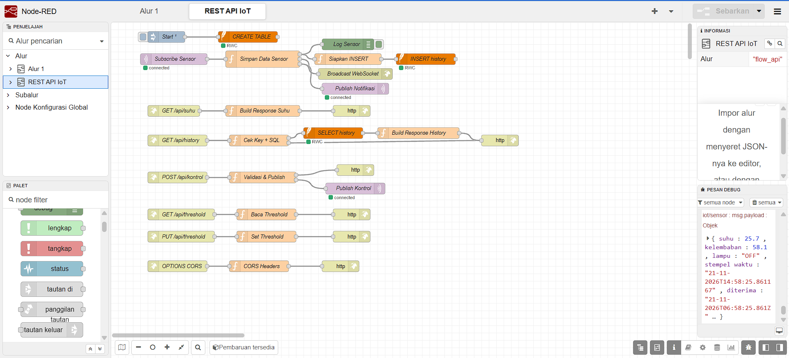
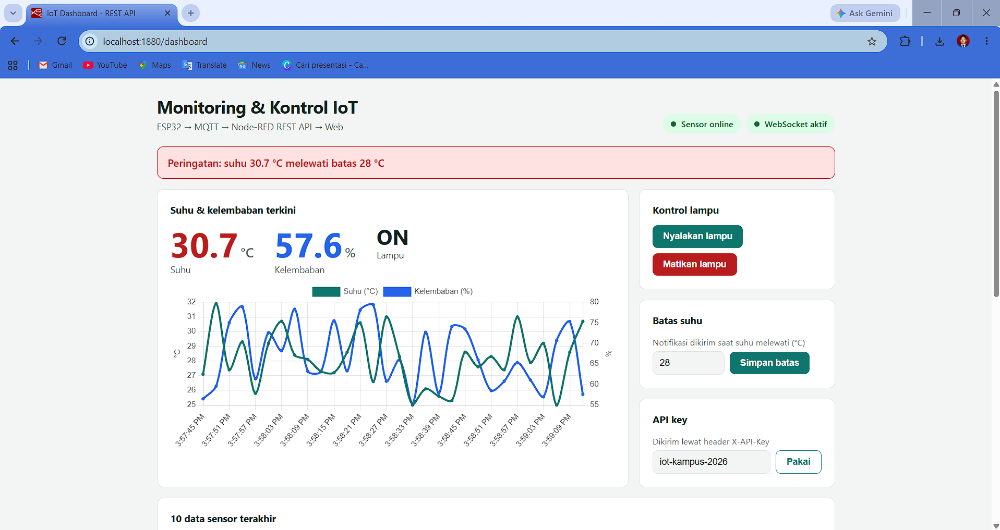
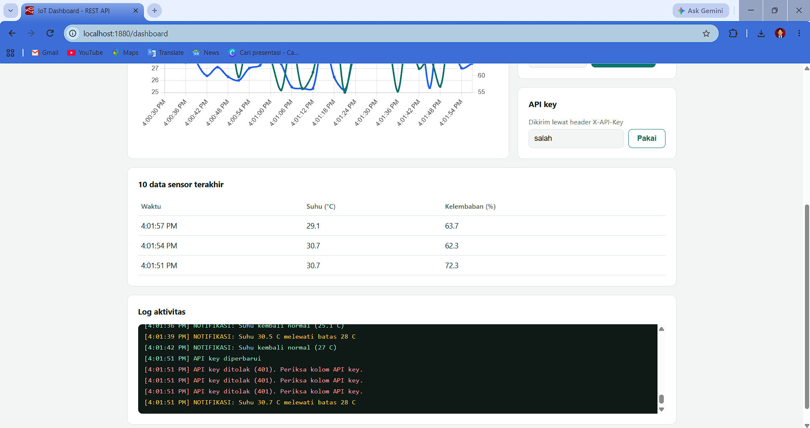
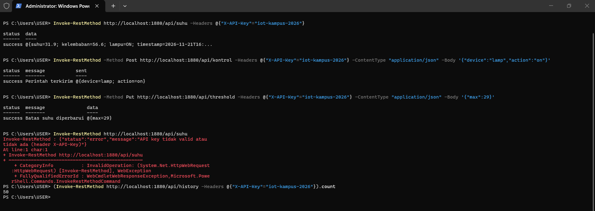

# IoT REST API dengan Node-RED

Tugas Pertemuan 9 - Pemrograman Internet of Things (SIF1502), Prodi Sistem Informasi, UNISKA Banjarmasin.

Sistem monitoring dan kontrol IoT: **ESP32 (simulasi) -> MQTT -> Node-RED (REST API) -> Dashboard Web (HTML/CSS/JS)**.

**Nama:** Akhmad Rizwar Afdhal  |  **NIM:** 2410020076  |  **Kelas:** 5A-SI-Reguler-Banjarbaru

## Arsitektur

```
simulasi_esp32.py --publish iot/sensor--> Mosquitto --> Node-RED --+--> flow context (data terakhir)
        ^                                                          +--> SQLite (history)
        +---------- subscribe iot/kontrol, iot/notifikasi <--------+--> WebSocket /ws/sensor --> Dashboard
                                                                   +--> REST API /api/* <-------- Dashboard
```

## Struktur repo

```
iot-rest-api/
├── README.md
├── requirements.txt
├── simulasi_esp32.py              # simulator ESP32 (publisher + subscriber)
├── node-red/
│   ├── flows.json                 # flow lengkap (dengan SQLite)
│   └── flows-tanpa-sqlite.json    # cadangan: history disimpan di flow context
├── public/
│   └── dashboard.html             # custom web dashboard
└── docs/screenshots/              # bukti uji coba
```

## Fitur

| Dasar | Bonus (tugas pengembangan) |
|---|---|
| GET `/api/suhu`, GET `/api/history`, POST `/api/kontrol` | PUT `/api/threshold` + notifikasi saat suhu melewati batas |
| MQTT subscribe/publish, CORS | Grafik real-time Chart.js |
| Dashboard fetch REST API | Autentikasi API key (`X-API-Key`) |
| | WebSocket `/ws/sensor` (tanpa polling, polling hanya cadangan) |
| | History disimpan di database SQLite |

## Endpoint

Semua endpoint (kecuali preflight `OPTIONS`) wajib header `X-API-Key: iot-kampus-2026`.

| Endpoint | Method | Fungsi | Body |
|---|---|---|---|
| `/api/suhu` | GET | Data sensor terakhir | - |
| `/api/history` | GET | 50 data sensor terakhir (dari SQLite) | - |
| `/api/kontrol` | POST | Kirim perintah ke ESP32 (publish `iot/kontrol`) | `{"device":"lamp","action":"on"}` |
| `/api/threshold` | GET | Lihat batas suhu | - |
| `/api/threshold` | PUT | Set batas suhu (default 30 C) | `{"max": 29.5}` |
| `ws://localhost:1880/ws/sensor` | WebSocket | Push data sensor & notifikasi | - |

Topik MQTT: `iot/sensor` (sensor -> Node-RED), `iot/kontrol` (Node-RED -> ESP32), `iot/notifikasi` (peringatan suhu).
Notifikasi dikirim saat status berubah: normal -> melewati batas, dan melewati batas -> normal.

## Cara menjalankan

### 1. Prasyarat
Node.js + Node-RED, Mosquitto, Python 3 + pip, dan browser modern.

### 2. Mosquitto
Pastikan `mosquitto.conf` berisi:
```
listener 1883
allow_anonymous true
```
Jalankan (Command Prompt):
```
cd /d D:\Mosquitto
mosquitto.exe -c mosquitto.conf -v
```

### 3. Node-RED
1. Instal node SQLite: menu ☰ -> **Manage palette** -> **Install** -> cari `node-red-node-sqlite` -> Install.
2. Buat folder `D:\iot-rest-api\` (database akan dibuat otomatis di `D:\iot-rest-api\iot_history.db`; ubah path di node config `sqlitedb` bila folder berbeda).
3. Menu ☰ -> **Import** -> pilih `node-red/flows.json` -> Import -> **Deploy**.
   (Jika SQLite gagal terpasang, import `flows-tanpa-sqlite.json`.)
4. Pastikan node MQTT berstatus **connected**.

### 4. Dashboard
Buka `public/dashboard.html` langsung di browser (CORS sudah ditangani flow), atau salin ke folder static Node-RED (`httpStatic` di `settings.js`) lalu buka `http://localhost:1880/dashboard.html`.

### 5. Simulator ESP32
```
pip install -r requirements.txt
python simulasi_esp32.py
```

## Pengujian

```
curl.exe http://localhost:1880/api/suhu -H "X-API-Key: iot-kampus-2026"
curl.exe http://localhost:1880/api/history -H "X-API-Key: iot-kampus-2026"
curl.exe -X POST http://localhost:1880/api/kontrol -H "Content-Type: application/json" -H "X-API-Key: iot-kampus-2026" -d "{\"device\":\"lamp\",\"action\":\"on\"}"
curl.exe -X PUT http://localhost:1880/api/threshold -H "Content-Type: application/json" -H "X-API-Key: iot-kampus-2026" -d "{\"max\":28}"
curl.exe http://localhost:1880/api/suhu
```
Perintah terakhir (tanpa key) harus mengembalikan **401**.

| Komponen | Cara verifikasi | Hasil |
|---|---|---|
| Simulator -> MQTT | Terminal simulator menampilkan `-> Publish` | sesuai |
| MQTT -> Node-RED | Debug panel menampilkan data sensor | sesuai |
| Node-RED -> REST | `curl` ke `/api/suhu` mengembalikan JSON | sesuai |
| REST -> Web | Angka dan grafik dashboard berubah | sesuai |
| Web -> REST -> MQTT | Klik tombol lampu, simulator menampilkan `KONTROL diterima` | sesuai |
| Threshold | Set batas 28 C, banner merah muncul, simulator menampilkan `NOTIFIKASI` | sesuai |
| API key | Request tanpa header mengembalikan 401 | sesuai |
| WebSocket | Pill "WebSocket aktif", tab Network tidak ada polling `/api/suhu` | sesuai |
| SQLite | Tabel `sensor_history` terisi, history bertahan setelah restart Node-RED | sesuai |

## Screenshot

Tambahkan gambar ke `docs/screenshots/` lalu tautkan di sini:






## Catatan keamanan

API key di tugas ini bersifat sederhana (string statis) dan terlihat di sisi klien, jadi hanya cocok untuk praktikum jaringan lokal. Koneksi WebSocket hanya mengirim data baca (tidak menerima perintah), sehingga tidak memakai API key. Untuk produksi gunakan HTTPS dan token per pengguna.
